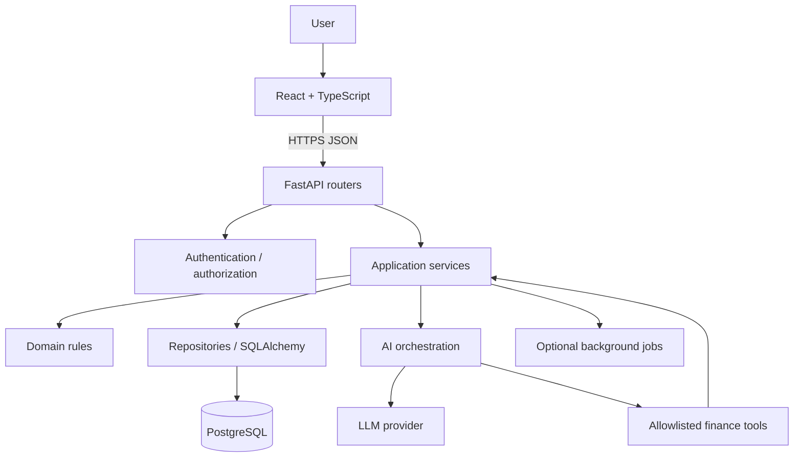

# SpendWise AI — Project Blueprint

> Master specification for product scope, architecture, implementation, testing, and interview preparation. Update this document only when an intentional design or scope decision changes.

## 1. Product vision

SpendWise AI is a personal finance management platform that helps users record financial activity, understand spending, plan budgets, and ask natural-language questions about their own financial data. It combines deterministic financial calculations with a grounded GenAI assistant.

**Primary value:** trustworthy financial visibility with an assistant that explains data rather than fabricating it.

**Target users:** individuals who want a clear view of income, expenses, accounts, budgets, and spending patterns.

## 2. Product principles

1. Financial records and calculations are deterministic; the LLM never invents balances or totals.
2. Every record is scoped to its owner. Authorization is enforced in backend queries and service boundaries.
3. Store money as decimal values backed by PostgreSQL NUMERIC/DECIMAL, never binary floating point.
4. A transfer is a paired, atomic operation; partial transfers must never persist.
5. AI tools are allowlisted, typed, read-only by default, and validated by the backend.
6. AI-generated mutations require explicit user confirmation and normal domain validation.
7. Every important feature has tests, documented failure modes, and observable behavior.
8. Build a modular monolith first; introduce distributed components only when justified.

## 3. Feature scope

### MVP
- Registration, login, logout, authenticated session/token handling.
- User profile and preferred currency/timezone.
- Financial accounts (cash, bank, wallet, credit card) with opening balance.
- Categories with system defaults and user-defined categories.
- Income and expense transactions with amount, currency, date, category, account, merchant/description, and notes.
- Transfers between owned accounts, with atomic debit/credit and transaction history.
- Transaction search, filters, sorting, and pagination.
- Dashboard: current account balances, income, expenses, net cash flow, monthly trend, category breakdown, recent transactions.
- Budgets by category and period, progress, threshold warnings.
- CSV import/export with validation and duplicate detection.
- Responsive React UI and clear empty/loading/error states.

### AI capabilities (after reliable core finance flows)
- Natural-language questions such as “How much did I spend on food last month?”
- Spending summaries and comparisons across periods.
- Budget status and unusual-spending explanations.
- Suggested categorization for uncategorized transactions.
- Receipt OCR/extraction as a later capability; extracted data must be reviewed before saving.
- Conversation history with references to the queried period/filters and a clear “as of” timestamp.

### Later enhancements
- Recurring transactions and reminders.
- Savings goals and financial insights.
- Multi-currency support with explicit exchange-rate source and conversion timestamp.
- Notifications, scheduled reports, and optional bank integrations.
- Advanced anomaly detection and forecasting only after sufficient data and evaluation.

## 4. Recommended technology stack

| Layer | Technology | Responsibility |
|---|---|---|
| Frontend | React + TypeScript + Vite | User interface |
| Styling | Tailwind CSS | Responsive design system |
| Backend | Python 3.12 + FastAPI | REST API and application composition |
| Validation | Pydantic | Request/response schemas |
| Persistence | PostgreSQL | Source of truth |
| ORM | SQLAlchemy 2.x | Database access and transactions |
| Migrations | Alembic | Versioned schema evolution |
| Authentication | Secure password hashing + JWT or secure cookie session | Identity |
| AI | Provider-agnostic LLM adapter with structured tool calling | Language interface |
| Testing | pytest, HTTPX, frontend test runner | Unit/integration/UI tests |
| Packaging | Docker + Compose | Reproducible local environment |
| Optional later | Redis + Celery/RQ | Caching and background work |

Do not add Redis, a message broker, microservices, vector databases, or Kubernetes to the MVP without a concrete requirement.

## 5. Architecture

Use a modular monolith with clear boundaries:



### Backend layers
- **API/router layer:** HTTP concerns, auth dependencies, request parsing, response codes.
- **Schema layer:** Pydantic input/output DTOs; never expose ORM objects directly.
- **Application/service layer:** use cases such as create transaction, transfer funds, compute dashboard.
- **Domain layer:** money, account, transaction, budget invariants and domain errors.
- **Repository/data layer:** SQLAlchemy queries and transaction boundaries.
- **Infrastructure:** database engine/session, password hashing, token provider, LLM adapter, logging.

### Request lifecycle
1. Browser sends request with auth credentials.
2. FastAPI validates identity and resolves current user.
3. Router validates input using Pydantic.
4. Service applies authorization and business rules.
5. Repository reads/writes through SQLAlchemy.
6. Database constraints and transaction commit enforce consistency.
7. Response schema serializes only permitted fields.
8. Errors are mapped to stable API error contracts and logged without secrets.

### AI request lifecycle
1. User question enters the AI endpoint.
2. Assistant receives a constrained system instruction and user-scoped tool definitions.
3. Model selects an allowlisted tool and structured arguments.
4. Backend validates arguments, authenticated user scope, date range, and permissions.
5. Tool calls deterministic service/query code; it cannot execute arbitrary SQL.
6. Results are returned to the model as trusted structured data.
7. Model explains results with scope/time context; backend can attach source metadata.
8. Mutating actions are excluded initially; later they require explicit confirmation and normal service validation.

## 6. Suggested repository structure

```text
SpendWise-AI/
├── docs/
│   ├── PROJECT_BLUEPRINT.md
│   ├── API_CONTRACT.md
│   ├── DATA_MODEL.md
│   └── decisions/
├── backend/
│   ├── app/
│   │   ├── api/v1/
│   │   ├── core/          # config, security, errors, logging
│   │   ├── db/            # engine, session, base
│   │   ├── models/
│   │   ├── schemas/
│   │   ├── repositories/
│   │   ├── services/
│   │   ├── domain/
│   │   ├── ai/            # provider adapter, prompts, tools
│   │   └── main.py
│   ├── alembic/
│   ├── tests/
│   ├── pyproject.toml
│   └── .env.example
├── frontend/
│   ├── src/
│   │   ├── api/
│   │   ├── components/
│   │   ├── features/
│   │   ├── hooks/
│   │   ├── layouts/
│   │   ├── pages/
│   │   ├── types/
│   │   └── main.tsx
│   └── package.json
├── infra/
│   └── docker-compose.yml
├── .github/workflows/
├── ENGINEERING_LOG.md
├── README.md
└── .gitignore
```

## 7. Data model (initial proposal)

All financial entities include owner/user scoping. Use UUID primary keys and UTC timestamps. Define currency explicitly (ISO 4217 code).

### users
- id, email (unique), password_hash, display_name
- preferred_currency, timezone, created_at, updated_at

### accounts
- id, user_id FK, name, account_type, currency
- opening_balance NUMERIC(19,4), is_active, created_at, updated_at

### categories
- id, user_id nullable for system categories, name, kind (income/expense), icon, color, is_system

### transactions
- id, user_id FK, account_id FK, category_id nullable FK
- transaction_type (income/expense/transfer), amount NUMERIC(19,4), currency
- description, merchant, transaction_date, notes
- transfer_group_id nullable, created_at, updated_at

For transfers, prefer a transfer aggregate plus two linked ledger entries or two linked transaction rows sharing an immutable transfer_group_id. Enforce both legs in one database transaction. Define whether account balance is derived from ledger entries or maintained as a cached balance; never mix approaches without reconciliation.

### budgets
- id, user_id FK, category_id FK, amount NUMERIC(19,4), currency
- period (monthly initially), start_date, end_date, created_at, updated_at

### ai_conversations / ai_messages (when AI feature is introduced)
- conversation id and owner id
- messages with role, content, timestamp, model/provider metadata
- tool calls/results stored with careful redaction and retention policy

### Data integrity rules
- amount > 0; transaction type controls direction.
- Account/category/user references must be ownership-checked, not merely valid IDs.
- A transaction currency must match the account currency in MVP, unless explicit conversion is implemented.
- Use database constraints for uniqueness and basic invariants.
- Use transactions for multi-row changes.
- Use idempotency keys for retryable create/transfer/import endpoints where duplicate execution would be harmful.
- Define deletion behavior (soft delete/archive vs hard delete) before implementing.

## 8. API outline (versioned under /api/v1)

| Method | Endpoint | Purpose |
|---|---|---|
| POST | /auth/register | Create account |
| POST | /auth/login | Authenticate |
| POST | /auth/logout | End session |
| GET/PATCH | /users/me | Current profile |
| GET/POST | /accounts | List/create accounts |
| GET/PATCH/DELETE | /accounts/{id} | Account details/update/archive |
| GET/POST | /categories | List/create categories |
| GET/POST | /transactions | List/create transactions |
| GET/PATCH/DELETE | /transactions/{id} | Transaction details/update/delete |
| POST | /transfers | Atomic transfer |
| GET/POST | /budgets | List/create budgets |
| GET/PATCH/DELETE | /budgets/{id} | Budget operations |
| GET | /analytics/summary | Summary for period |
| GET | /analytics/trends | Time series |
| GET | /analytics/categories | Category totals |
| POST | /ai/chat | Grounded natural-language assistant |

List endpoints should support bounded pagination, deterministic sorting, and validated filters. Use consistent error responses and appropriate HTTP status codes.

## 9. Financial correctness and security

- Use Python Decimal and PostgreSQL NUMERIC; quantize only according to currency rules.
- Never use float for money or aggregate calculations.
- Make timezone and date-range semantics explicit; persist timestamps in UTC and interpret user reporting periods in their configured timezone.
- Validate all resource ownership in the service/query, including nested resources and AI tools.
- Hash passwords with Argon2id or bcrypt using a maintained library.
- Store secrets in environment variables/secret manager; commit only .env.example.
- Configure CORS narrowly, validate inputs, rate-limit authentication and AI endpoints, and avoid logging tokens, passwords, or sensitive financial details.
- Protect against SQL injection using ORM/parameterized queries.
- AI system prompts are not an authorization boundary; enforce permissions in code.
- Treat imported descriptions, receipts, and user-provided text as untrusted input (prompt injection defense).
- Do not send unnecessary personal financial data to an LLM; minimize and redact context.
- Provide user-visible explanation of AI data scope and limitations.

## 10. Testing strategy

- Unit tests: domain rules, Decimal calculations, budget calculations, validation.
- Repository/integration tests: constraints, ownership filtering, transactions, migrations.
- API tests: auth, status codes, pagination, invalid payloads, cross-user access denial.
- Transfer tests: success, rollback, concurrent requests, idempotent retry, insufficient funds if enforced.
- Analytics tests: date boundaries, empty periods, category aggregation, timezone handling.
- AI tests: tool allowlist, invalid arguments, unauthorized resource attempts, prompt injection, grounding, empty data, model/provider failure, deterministic tool outputs.
- Frontend tests: forms, filters, dashboard states, API error/loading states.
- Run lint, type checks, unit and integration tests in CI. Record exact commands and results in ENGINEERING_LOG.md.

## 11. Observability and reliability

Use structured logs with request/correlation IDs; redact secrets and sensitive fields. Track request latency, error rate, DB query latency, AI provider latency/token usage, tool-call errors, and background-job failures. Add health/readiness endpoints. Retry only transient failures and only when operations are idempotent. Set timeouts and bounded retries for external providers.

## 12. Four-week implementation roadmap (adjust to actual pace)

### Week 1 — Foundations
- Initialize repo structure, Python environment, FastAPI app, config, Docker Compose, PostgreSQL.
- SQLAlchemy setup and Alembic baseline.
- User model, registration/login, auth tests.
- User profile and account CRUD.
**Exit criteria:** app runs locally; migrations work; auth and ownership tests pass.

### Week 2 — Finance core
- Categories and transaction CRUD.
- Atomic transfers and idempotency.
- Account balance strategy and reconciliation tests.
- Budgets and deterministic analytics endpoints.
**Exit criteria:** core finance flows pass unit/integration tests and cannot leak cross-user data.

### Week 3 — Product quality
- React app, auth flow, dashboard, accounts, transactions, budgets.
- Filtering/pagination, forms, empty/error/loading states.
- CSV import/export, audit/history decisions, security hardening.
**Exit criteria:** main user journeys work end-to-end and are tested.

### Week 4 — AI and delivery
- LLM adapter, allowlisted read-only tools, grounded assistant.
- AI evaluation and failure handling.
- Dockerized full stack, CI, deployment, screenshots/demo, docs.
**Exit criteria:** deployed demo, reproducible setup, tests/CI passing, interview guide updated.

## 13. Definition of done

A feature is not complete because code was generated. It is complete only when:
- acceptance criteria are explicit;
- implementation is in the repository;
- tests are added and run;
- authorization and failure cases are considered;
- API/docs are updated;
- engineering log records files, design decisions, commands and results;
- interview guide records the real design and trade-offs.

## 14. Interview preparation template

For each implemented feature, record:
1. Problem and requirements.
2. High-level design and request/data flow.
3. Schema, constraints, indexes and query shape.
4. Code paths and responsibility of each layer.
5. Alternatives considered and why selected.
6. Correctness, concurrency, security and failure handling.
7. Tests actually run and verified results.
8. Performance bottlenecks and measured evidence (never invented).
9. 5–10 interview questions with concise answers.
10. Follow-up improvements and known limitations.

## 15. Project documentation policy

- This file is the source of truth for intended architecture and scope.
- ENGINEERING_LOG.md is the chronological record of actual work.
- Notion Progress Tracker is the task/milestone view.
- Notion Interview Ready is the implementation-linked interview knowledge base.
- Never label planned work as implemented, tested, or deployed.
- Every session ends with a handoff: completed, changed files, commands/tests/results, decisions, blockers, next exact task, and docs to update.
